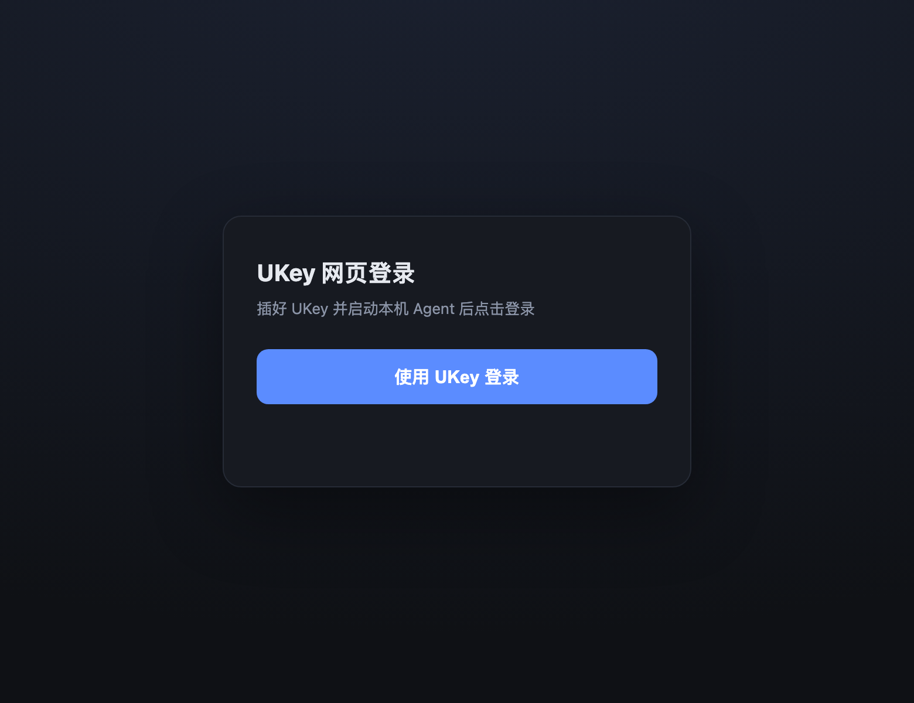
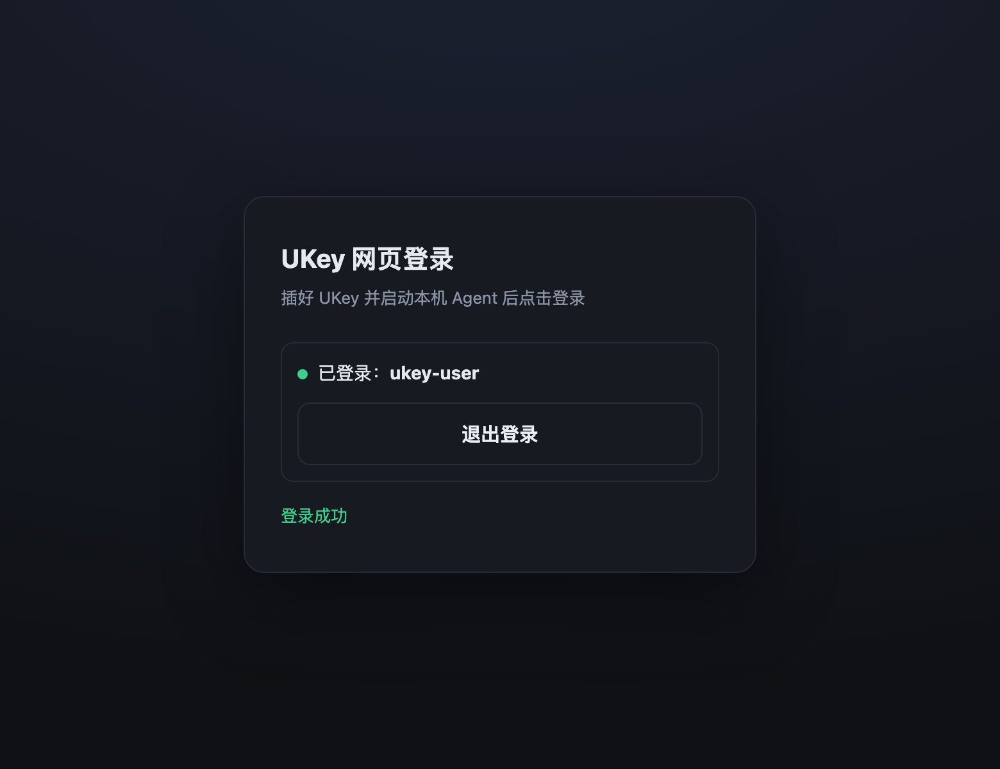
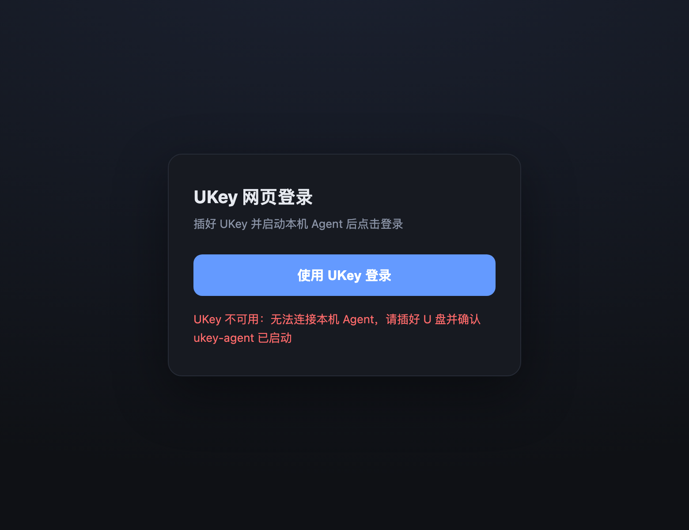
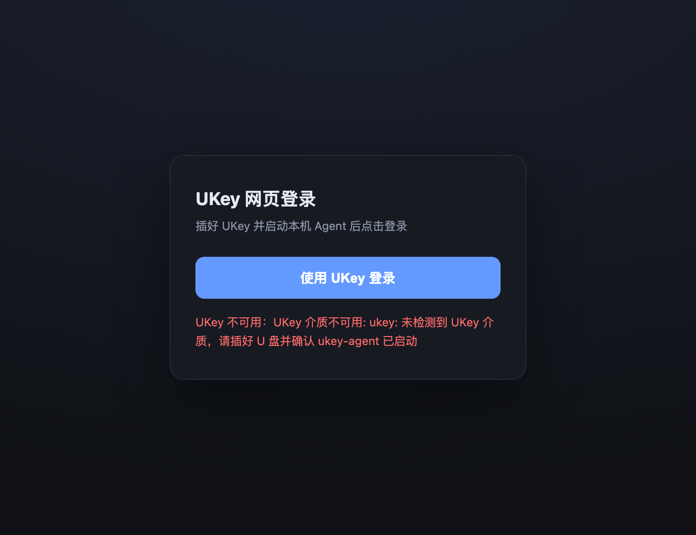

# UKey 使用手册（从零到网页登录）

按顺序做，不要跳步。口令只在第 2 步「初始化」时设置，后面的 Agent 和 demo-app 都是**输入这个已设置的口令**，不是重新生成。

```
初始化（设口令）→ 签发 License → 验证授权 → 启动网页登录 → 试异常情况
```

---

## 0. 准备

- 已安装 Go：`go version` 能输出版本。
- U 盘已插上，挂载点用 `ls /Volumes` 确认。下文以 `/Volumes/TRIM INSTAL` 为例。
- 所有命令都在项目根目录执行：

```bash
cd /Users/yang/Documents/Trae-CN/temp_20261120_02
```

厂商密钥（`vendor.key`）是签发 License 的唯一私钥，**要放在不会被清理的目录**，丢了就再也签不了新授权。下文统一用 `~/ukey-vendor.key`。

---

## 1. 初始化：设置口令

只有这一步是「生成」口令。

```bash
go run ./cmd/keygen init \
  --dir "/Volumes/TRIM INSTAL" \
  --vendor ~/ukey-vendor.key
```

执行后会提示：

```
设置 UKey 口令（至少 8 位）:
再次输入确认:
```

输入时屏幕不动是正常的。示例口令 `pass-12345`（至少 8 位）。

成功输出：

```
UKey 初始化完成
  挂载点        : /Volumes/TRIM INSTAL
  KeyID         : 7e6509b249dbcdabd35935f1d9bf16df
  指纹类型      : 卷 UUID
```

这个 KeyID 要记住，后面出问题时要对。

**盘上已经初始化过**（报「该介质已存在 UKey」）时有两种选择：

- 记得旧口令：跳过本步，直接做第 2 步。
- 忘了旧口令：加 `--force` 重建，KeyID 会变，第 2 步必须重签 License：

```bash
UKEY_PASSPHRASE='pass-12345' go run ./cmd/keygen init \
  --dir "/Volumes/TRIM INSTAL" --vendor ~/ukey-vendor.key --force
```

> 非交互场景用 `UKEY_PASSPHRASE` 环境变量代替两次手动输入。

---

## 2. 签发 License

这一步不需要口令，用厂商私钥签名，默认绑定本机机器码。

```bash
go run ./cmd/keygen issue \
  --key "/Volumes/TRIM INSTAL" \
  --vendor ~/ukey-vendor.key \
  --features pro --expire 2027-12-31 --serial USB-REAL-001
```

确认结果（只读，不需要口令）：

```bash
go run ./cmd/keygen info --dir "/Volumes/TRIM INSTAL"
```

要看到 `KeyID` 与第 1 步一致、`License` 下有 `pro` 和有效期。

---

## 3. 验证授权 + 看拔盘提示

```bash
go run ./cmd/demo-app --vol "/Volumes/TRIM INSTAL"
```

输入口令，看到：

```
[启动] KeyID=7e6509... 有效期=... ~ 2027-12-31
[业务] 第 1 轮运行中
[业务] 第 2 轮运行中
```

**此时物理拔掉 U 盘**，约 1 秒后同一个终端打印：

```
[!] UKey 已移除，进入受限模式
[退出] 受限模式，业务已停止
```

这就是拔盘提示，在运行 demo-app 的终端里看；Agent 也有同样的提示（约 1 秒后打印 `[!] UKey 已移除，登录签名将被拒绝`），见第 4、5.7 节。

- demo-app 重新插上**不会自动恢复**，要重跑命令（Agent 不需要，插回即可用）。
- 只想退出：`Ctrl+C`。

---

## 4. 启动网页登录

网页登录需要两个进程，**顺序不能反**：先 Agent，后 Web。

### 4.1 终端 A：启动本机 Agent

```bash
go run ./cmd/ukey-agent --vol "/Volumes/TRIM INSTAL"
```

输入同一个口令。成功输出：

```
UKey Agent 已启动: http://127.0.0.1:18765
  KeyID    : 7e6509...
  允许来源 : http://127.0.0.1:8080,http://localhost:8080
```

这个终端保持运行。

### 4.2 终端 B：启动登录页

```bash
go run ./cmd/ukey-web --listen 127.0.0.1:8080
```

成功输出：

```
警告: 公钥来自本机 Agent（演示便利），生产请用 -pubkey 静态注册
UKey 登录页: http://127.0.0.1:8080/
```

### 4.3 浏览器

打开 http://127.0.0.1:8080/ ，点「使用 UKey 登录」。

看到已登录用户和「登出」按钮即成功。想看细节按 F12 → Network，应有 4 个请求且都是 200：

```
POST /api/challenge
POST 127.0.0.1:18765/sign
POST /api/login
GET  /api/me
```

点「登出」回到未登录状态。

> 若 Web 启动时报 `connection refused`，说明终端 A 的 Agent 没起来或先起了 Web，关掉重来。

效果对照：

| 插好 U 盘、未登录 | 登录成功 |
|---|---|
|  |  |

---

## 5. 异常验证

逐条做，看是否和预期一致。

### 5.1 没启动 Agent 就点登录

关掉终端 A（`Ctrl+C`），刷新页面点登录。页面提示「UKey 不可用：无法连接本机 Agent」，不会假装成功。



### 5.2 口令输错

重跑 Agent 故意输错一次，报：

```
错误: ukey: 口令错误
```

**不要连续试 5 次**，会锁定（见第 6 节）。

### 5.3 把密钥拷到别的目录

```bash
mkdir -p /tmp/stolen && cp -R "/Volumes/TRIM INSTAL/.ukey" /tmp/stolen/
go run ./cmd/keygen verify --dir /tmp/stolen
```

预期：`错误: ukey: 介质校验失败`。密钥绑定这块盘的卷 UUID，拷走无效。

### 5.4 跨站调用 Agent

```bash
curl -H 'Origin: http://evil.example' http://127.0.0.1:18765/ping
```

预期 403。不带 Origin 的 curl（本机程序）是允许的。

### 5.5 让 Agent 签非登录消息

```bash
curl -X POST http://127.0.0.1:18765/sign \
  -H 'Content-Type: application/json' -d '{"messageHex":"70617920313030"}'
```

`70617920313030` 是 `pay 100`，预期 400「不支持的消息类型」。Agent 不是通用签名机。

### 5.6 重放登录请求

登录成功后 F12 → Network → 右键 `/api/login` → Replay。预期 401，challenge 用完即删。

### 5.7 拔盘后再点登录

先启动好 Agent 和登录页，然后拔掉 U 盘。

- Agent 终端约 1 秒后打印：`[!] UKey 已移除，登录签名将被拒绝`。
- 页面点登录，提示 `UKey 不可用：UKey 介质不可用: ukey: 未检测到 UKey 介质...`。
- 直接调接口：`/ping` 返回 503，`/sign` 返回 401。

把 U 盘插回去（不用重启 Agent），再点登录即恢复。已登录的会话不会因为拔盘而失效，这是 Demo 的取舍。



---

## 6. 忘记口令 / 被锁定

| 现象 | 原因 | 处理 |
|---|---|---|
| `ukey: 口令错误` | 口令不对，失败次数 +1 | 想清楚再试，别连错 5 次 |
| `ukey: 介质已锁定，失败次数超限` | 连错 5 次 | 只能重建（下面命令） |
| 重建后 `License 与当前 UKey 不匹配` | 换了 KeyID 但没重签 | 重跑第 2 步 issue |

解锁/重建（会换 KeyID，License 必须重签）：

```bash
UKEY_PASSPHRASE='pass-12345' go run ./cmd/keygen init \
  --dir "/Volumes/TRIM INSTAL" --vendor ~/ukey-vendor.key --force

go run ./cmd/keygen issue \
  --key "/Volumes/TRIM INSTAL" --vendor ~/ukey-vendor.key \
  --features pro --expire 2027-12-31 --serial USB-REAL-001
```

---

## 7. 不想插 U 盘时怎么练

用普通目录模拟，所有命令加 `--salt none`（关闭介质指纹绑定）。

```bash
D=/tmp/ukey-demo; rm -rf $D; mkdir -p $D
export UKEY_PASSPHRASE=pass-12345

go run ./cmd/keygen init  --dir $D --vendor ~/ukey-vendor.key --salt none
go run ./cmd/keygen issue --key $D --vendor ~/ukey-vendor.key --features pro --expire 2027-12-31
go run ./cmd/keygen verify --dir $D
go run ./cmd/demo-app --vol $D --feature pro --salt none
```

网页登录同理，把 `--vol $D --salt none` 传给 Agent：

```bash
go run ./cmd/ukey-agent --vol /tmp/ukey-demo --salt none
go run ./cmd/ukey-web --listen 127.0.0.1:8080
```

---

## 8. 报错对照表

| 报错 | 含义 | 怎么办 |
|---|---|---|
| `ukey: 未检测到 UKey 介质` | 盘没插、路径不对、没有 `.ukey` | 查 `ls /Volumes`，先做第 1 步 |
| `ukey: 介质校验失败` | 密钥被拷到别的盘 | 换回原盘 |
| `ukey: 口令错误` | 口令不对 | 重输，别超 5 次 |
| `ukey: 介质已锁定，失败次数超限` | 连错 5 次 | 第 6 节重建 |
| `ukey: License 与当前 UKey 不匹配` | KeyID 不一致（重建后没重签） | 重跑第 2 步 |
| `ukey: License 已过期` / `尚未生效` | 时间不在许可区间 | 重签或调整 `--expire` |
| `ukey: 机器码不符` | License 绑的是别的机器 | 用本机 `keygen machine-code` 重签 |
| `ukey: 检测到系统时间回拨` | 系统时间被往回调 | 校准系统时间 |
| `ukey: 当前授权不包含该功能` | `--feature` 不在 License 里 | 重签时加该功能 |
| `未指定 -pubkey，且无法从 Agent 获取公钥` | Web 启动时 Agent 还没起 | 先起 Agent |

---

## 附：口令规则

- 只在初始化时设置，至少 8 位。
- 不通过命令行参数传递；交互输入用隐藏回显，脚本里用 `UKEY_PASSPHRASE` 或管道。
- 口令用于 PBKDF2-SM3（默认 10 万次迭代）派生 SM4 密钥，解密盘上的私钥材料，所以口令错就无法解出私钥。
